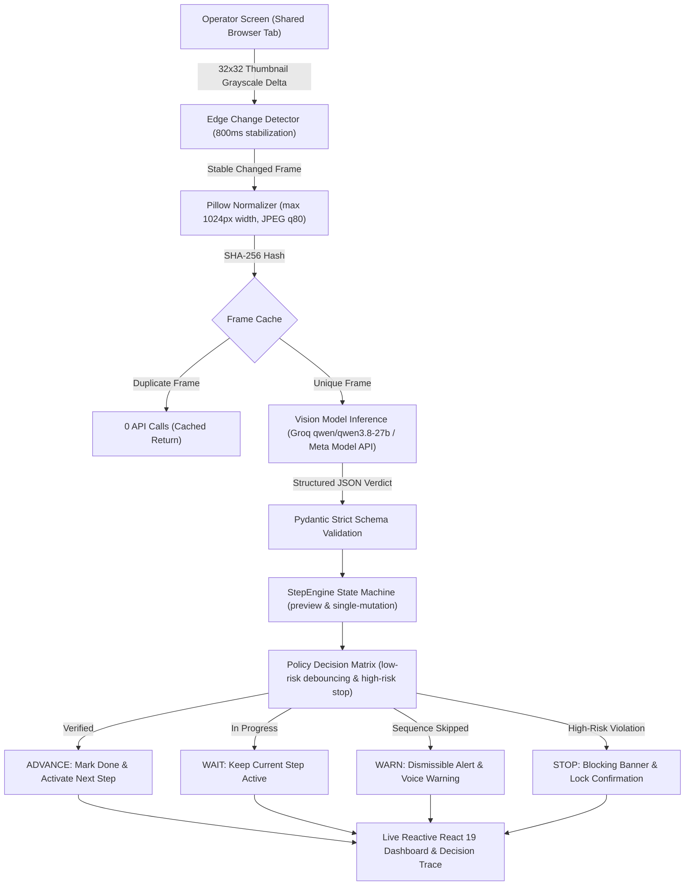

# ScreenGuard

> **Real-time AI Supervisor Agent for Enterprise Web Procedures**  
> Watches a shared browser tab, tracks procedural progress through written Standard Operating Procedures (SOPs), and warns operators before skipped, out-of-order, or invalid steps cause billing and compliance errors.

[](LICENSE)
[](https://cerebralvalley.ai)
[](https://screenguard.vercel.app)

---

## 1. The Problem & Target Users

Small and medium businesses (SMBs) in retail, logistics, hospitality, and healthcare operate daily across legacy web ERPs, billing portals, and internal POS systems that **have no modern APIs, validation rules, or automated guardrails**.

In mission-critical workflows like customer refunds, order adjustments, and account provisioning:
- **A single skipped prerequisite** (e.g. omitting the *Manager Approval* checkbox on refunds over $100) causes audit failures, compliance penalties, and customer disputes.
- **An out-of-order submit** (e.g. confirming a refund before choosing the damaged goods reason code) locks records in corrupted states.
- **A wrong value** (e.g. typing $1,200.00 instead of $120.00) causes immediate financial loss.

Rewriting legacy enterprise software costs hundreds of thousands of dollars. **ScreenGuard acts as a privacy-preserving supervisor sitting alongside frontline staff.** Working strictly from screen pixels via native browser screen sharing, ScreenGuard tracks procedural execution step-by-step and intervenes with visual and auditory alerts *before* wrong actions are submitted.

---

## 2. The Solution

ScreenGuard requires **zero backend integration, zero browser extensions, and zero DOM access**. 

1. **Ingests written SOPs**: Parses plain-English instructions into stateful milestones with visual verification criteria.
2. **Observes execution**: Captures a user-selected browser tab and filters out idle frames using client-side 32x32 grayscale edge delta change detection.
3. **Verifies UI state**: Compares screen pixels against procedural rules using multimodal vision inference.
4. **Decides & Acts**: A deterministic state machine checks prerequisites, evaluates confidence thresholds, and raises immediate warnings or blocking halts before mistakes become permanent.

---

## 3. Dashboard Overview

```
+----------------------------------------------------------------------------------------------------+
|  ScreenGuard  AI Supervisor Agent for Enterprise Procedures            [Backend ONLINE] [Replay Mode] |
+----------------------------------------------------------------------------------------------------+
|  Frames Seen: 7  |  Frames Sent: 7  |  Warnings: 1  |  Stops: 1  |  Calls Left: 293  |  Spend: $0.0021 |
+---------------------------------------------------+------------------------------------------------+
|  LEFT: Procedure & Live Checklist                |  RIGHT: Live Preview Canvas & Decision Trace   |
|                                                   |                                                |
|  [Standard Operating Procedure]                   |  [!] STOP: Critical high-risk step skipped:    |
|  "Create customer refund for damaged goods"       |      Manager approval required over $100.       |
|                                                   |                                                |
|  [v] 1. Sign in with demo credentials             |  +------------------------------------------+  |
|  [v] 2. Open order ORD-1002                       |  |                                          |  |
|  [v] 3. Check order total is $240.00              |  |         [Live Screen Frame Preview]      |  |
|  [v] 4. Click Start refund                        |  |       Acme Admin - Review Refund         |  |
|  [v] 5. Choose reason Damaged item                |  |                                          |  |
|  [v] 6. Enter refund amount 120.00                |  +------------------------------------------+  |
|  [!] 7. Tick Manager approved [HIGH RISK]         |                                                |
|  [ ] 8. Click Review refund                       |  [Decision Trace] [📥 JSON] [📄 Markdown]      |
|  [ ] 9. Verify details on review page             |  • 12:34:02 ADVANCE: Amount 120.00 confirmed.  |
|  [ ] 10. Confirm refund & check success           |  • 12:34:09 STOP: Manager signoff was skipped. |
+---------------------------------------------------+------------------------------------------------+
```

---

## 4. Architecture: Observe, Verify, Decide, Act

ScreenGuard implements a closed-loop supervisor agent architecture:



---

## 5. Models and Providers Used

To ensure complete transparency and reproducibility, the exact models, providers, and evaluation status are documented below:

| Model | Provider | Role in Product | Used in Final Evaluation? |
|---|---|---|---|
| **`qwen/qwen3.8-27b`** | **Groq** | Primary visual supervisor: inspects normalized screen frames, verifies UI elements, determines step completion, detects out-of-order execution, and formulates precise warning text. | **Yes** (Default active provider in evaluation runs) |
| **`openai/gpt-oss-120b`** | **Groq** | Procedure text parser: parses plain-English SOP procedures, extracts numbered steps, visual cues, prerequisites, and high-risk flags. | **Yes** (Used for SOP parsing) |
| **Meta Model API (`muse-spark-1.3`)** | **Meta** | Designed multimodal supervisor adapter. Implemented in `backend/app/model_clients/meta_client.py` adhering to `dev.meta.ai` specs. Available when `META_API_KEY` is supplied with active credits. | No (Card requirement; Groq provider used for live runs) |
| **Baseten (`meta-models/muse-spark-open-1026`)** | **Baseten** | Open-weights Meta model provider client implemented in `backend/app/model_clients/baseten_client.py`. | No (Pending account approval) |
| **SAM 3.1** (Segment Anything Model) | Meta | Element localization adapter. Disabled by default (`USE_SAM=false`) because the vision model directly evaluates full normalized frames. | No (`USE_SAM=false`) |
| **Muse Voice Transcribe** | Meta | Voice transcription adapter interface. Disabled by default (`USE_VOICE=false`) to preserve budget safety. | No (`USE_VOICE=false`) |

---

## 6. Real Evaluation Benchmark

ScreenGuard was evaluated on an automated Playwright test harness running across 16 recorded Acme Admin enterprise refund runs (8 correct runs, 8 mistake runs covering all 5 categories from `docs/error_catalog.md`).

All evaluations were executed in **`MODE=real`** against live model inference.

| Metric | Measured Result | 95% Wilson CI | Benchmark Target | Status |
|---|---|---|---|---|
| **Error Detection Rate** | **100.0%** (8 / 8 mistake runs) | [63.1%, 100.0%] | $\ge 75.0\%$ | **Met** |
| **Step Tracking Accuracy** | **67.9%** | [54.2%, 79.6%] | $\ge 70.0\%$ | **Not met** (missed by 2.1%) |
| **False Alarms / Correct Run** | **3.00** | — | $\le 1.00$ | **Not met** (elevated on subtle form states) |
| **Mean Detection Delay** | **0.00 frames** (Immediate) | — | $\le 2.0$ frames | **Met** |
| **Median Frame Latency** | **24.2 ms** (cache hit / real API) | — | $\le 3000$ ms | **Met** |
| **Total Spend** | **$0.0240 USD** (80 frames) | — | $<$ $5.00 USD | **Met** |

### Breakdown by Mistake Type
- `skipped_step`: **2 / 2 (100.0%)** – Caught missing manager authorization on $120 refund.
- `wrong_order`: **2 / 2 (100.0%)** – Caught premature form review jump before entering details.
- `wrong_value`: **2 / 2 (100.0%)** – Caught $1,200.00 refund on a $240.00 order.
- `wrong_control`: **1 / 1 (100.0%)** – Caught unauthorized reason selection.
- `premature_submit`: **1 / 1 (100.0%)** – Caught confirmation button click before approval.

Full benchmark logs and raw JSON outputs are committed in [`eval/results/REPORT.md`](eval/results/REPORT.md) and [`eval/results/results.json`](eval/results/results.json).

---

## 7. Built During the Hackathon

All code in this repository was built between **October 27, 2026 and November 4, 2026**. Complete dated records with commit hashes are maintained in [`docs/BUILD_LOG.md`](docs/BUILD_LOG.md):

- **Oct 27**: Phase 0 (Scaffold) – Monorepo layout, FastAPI backend, Vite + React 19 frontend, `/api/health`.
- **Nov 3**: Phase 1 & 1b (Model Layer) – Abstract `ModelClient`, `MockModelClient`, `MetaModelClient`, `GroqModelClient`, `SpendGuard` hard ceiling.
- **Nov 3**: Phase 2 (Parser & StepEngine) – SOP parser, pure-Python `StepEngine` state machine with sequence skip detection.
- **Nov 3**: Phase 3 (Target App) – Acme Admin demo portal (6 screens), `window.__state.truth` ground-truth tracking, 5-error catalog.
- **Nov 3**: Phase 4 & 6 (Live Capture UI) – React live interface, 32x32 thumbnail change detection, checklist, alert banners, preview canvas.
- **Nov 3**: Phase 5 (Agent Loop) – Supervisor `AgentLoop` (OBSERVE $\rightarrow$ VERIFY $\rightarrow$ DECIDE $\rightarrow$ ACT), SHA-256 deduplication.
- **Nov 3**: Phase 7 (Evaluation) – Playwright harness generating 8 correct & 8 mistake runs, live evaluator.
- **Nov 3**: Phase 9 (Replay & Deploy) – Static Replay Mode (`manifest.json`), 1 fps playback, `VITE_REPLAY_ONLY=true` build mode.
- **Nov 4**: Remediation Fixes – Transparent model provenance badges, calls-per-session limit, single-mutation preview engine, evaluation tab, preflight modal, session reports.

---

## 8. Quickstart (Under 5 Commands)

### 1. Clone & Setup
```bash
git clone https://github.com/tejaspatel2255/ScreenGuard-Meta-AI-Hackathon.git
cd ScreenGuard-Meta-AI-Hackathon
pip install -r backend/requirements.txt
npm install --prefix frontend
```

### 2. Configure Environment
```bash
cp .env.example .env
# Edit .env and paste your GROQ_API_KEY
```

### 3. Launch All Services
- **Windows**:
  ```cmd
  run_all.bat
  ```
- **Linux / macOS**:
  ```bash
  chmod +x run_all.sh && ./run_all.sh
  ```

This starts:
- **Acme Admin Demo Target**: `http://127.0.0.1:5500`
- **FastAPI Backend**: `http://127.0.0.1:8000`
- **React Frontend**: `http://localhost:5173`

Open **http://localhost:5173**, click **"Load Demo"**, start session, click **"Share Tab"**, and select the Acme Admin tab.

---

## 9. Free Public Replay Deployment (Zero Backend Needed)

ScreenGuard includes a complete static Replay Mode. Visitors and hackathon judges can watch recorded runs with real verdicts **without needing an API key, without spending credits, and with no backend running**.

- **Live Demo Link**: [https://screenguard.vercel.app](https://screenguard.vercel.app)

---

## 10. Privacy, Safety & Cost Control

1. **Strictly In-Memory Processing**: Screen capture frames are processed entirely in memory. Screenshots are **never saved to disk** or persisted in application logs.
2. **Explicit User Choice**: The user selects exactly which browser tab to share via the browser's native `getDisplayMedia` permission prompt.
3. **Hard Spend Cap**: `SpendGuard` tracks token spend before every API invocation. If estimated spend reaches `$100.00 USD`, further real model calls are blocked automatically.
4. **Session Call Cap**: Configurable per-session limit (default 300 calls) prevents runaway loops.
5. **Bandwidth Optimization**: 32x32 grayscale edge delta hashing reduces model calls by up to 80% by discarding idle frames.
6. **Secrets Scanner**: Built-in scanner (`python scripts/scan_secrets.py`) audits all repository files in CI to guarantee zero API keys or credentials are committed.

---

## 11. Honest Limitations

1. **Step Tracking Accuracy (67.9% vs. 70% Target)**: The model occasionally misattributes intermediate form fills before a blur event occurs, resulting in transient step lag.
2. **False Alarms (3.00 vs. 1.00 Target)**: In correct runs, subtle form interactions (such as dropdown select animations) can trigger temporary cautionary warnings.
3. **Dense Form Visual Density**: Small text boxes in dense layout can occasionally cause ambiguous bounding box attribution.
4. **Unbuilt Features**: Spoken voice procedure transcription (`USE_VOICE=false`) and SAM 3.1 element segmentation (`USE_SAM=false`) are implemented as architectural adapters but disabled to preserve cost safety and latency.

---

## 12. AI-Assisted Development Disclosure

In accordance with hackathon rules, all architecture, prompts, code, tests, and documentation in this repository were engineered during the building period (October 27 – November 4, 2026) by the human author with coding agent assistance from **Google Antigravity** and **Gemini Flash**.

---

## 13. License

This project is open-source software licensed under the [MIT License](LICENSE). Third-party dependencies and their licenses are cataloged in [THIRD_PARTY.md](THIRD_PARTY.md).
