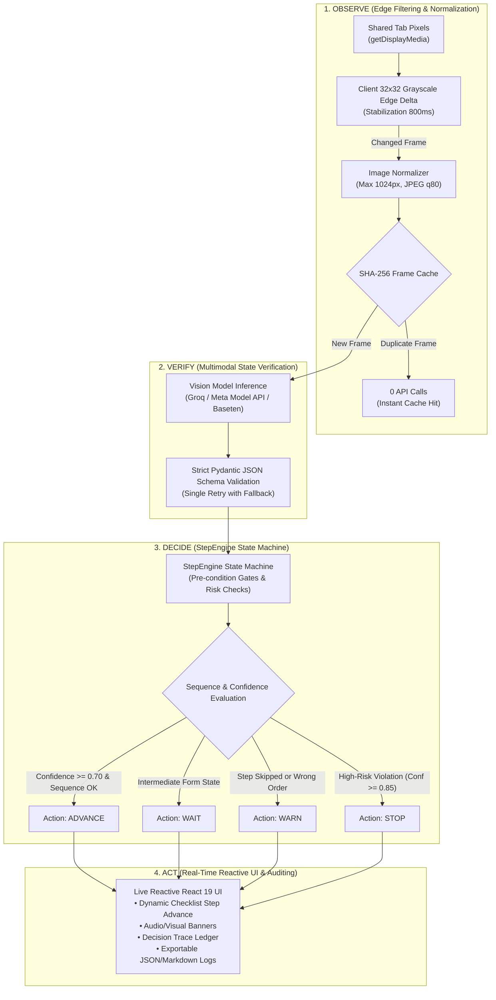

# ScreenGuard 🛡️

> **Real-time AI Supervisor Agent for Enterprise Web Procedures**  
> *Watches a shared browser tab, tracks procedural execution through written Standard Operating Procedures (SOPs), and proactively intervenes before skipped, out-of-order, or invalid actions cause compliance violations and financial loss.*

<div align="center">

[](https://cerebralvalley.ai)
[](docs/hackathon_rules.md)
[](https://screenguard.vercel.app)
[](LICENSE)

[**🌐 Live Interactive Replay**](https://screenguard.vercel.app) • [**📋 Hackathon Build Log**](docs/BUILD_LOG.md) • [**📊 Benchmark Report**](eval/results/REPORT.md) • [**⚠️ Error Catalog**](docs/error_catalog.md)

</div>

---

## 📌 Table of Contents
1. [The Problem: Fragile Workflows in Legacy Systems](#1-the-problem-fragile-workflows-in-legacy-systems)
2. [The Solution: Non-Invasive Pixel-Level Supervision](#2-the-solution-non-invasive-pixel-level-supervision)
3. [Agent Architecture (Observe, Verify, Decide, Act)](#3-agent-architecture-observe-verify-decide-act)
4. [Live Dashboard & Interface](#4-live-dashboard--interface)
5. [Models & Provider Adapters](#5-models--provider-adapters)
6. [Empirical Evaluation & Benchmark Results](#6-empirical-evaluation--benchmark-results)
7. [Hackathon Timeline & Verification](#7-hackathon-timeline--verification)
8. [Quickstart (3 Steps, Under 5 Minutes)](#8-quickstart-3-steps-under-5-minutes)
9. [Zero-Backend Static Replay Mode](#9-zero-backend-static-replay-mode)
10. [Privacy, Safety & Spend Guardrails](#10-privacy-safety--spend-guardrails)
11. [Honest Disclosures & Limitations](#11-honest-disclosures--limitations)
12. [License & Third-Party Credits](#12-license--third-party-credits)

---

## 1. The Problem: Fragile Workflows in Legacy Systems

Frontline employees across retail, logistics, hospitality, and healthcare execute complex Standard Operating Procedures (SOPs) on legacy web ERPs, POS portals, and internal admin software every single day. 

These legacy tools **lack APIs, modern validation rules, or procedural safety rails**:
- **Skipped Prerequisites**: Forgetting a mandatory *Manager Approval* checkbox on customer refunds over $100 causes chargebacks, audit penalties, and regulatory fines.
- **Out-of-Order Execution**: Clicking *Confirm* before setting a return reason code corrupts inventory databases and locks records.
- **Input & Control Errors**: Miskeying `$1,200.00` instead of `$120.00` leads to immediate financial loss before accounting catches it.

> Re-architecting legacy systems costs tens of thousands of dollars and months of engineering time. Small and medium businesses (SMBs) simply cannot afford full software rewrites.

---

## 2. The Solution: Non-Invasive Pixel-Level Supervision

**ScreenGuard** is an autonomous AI supervisor agent that sits alongside frontline operators. It watches screen updates from a shared browser tab, compares what it sees against plain-English SOPs, and halts or alerts operators **before mistakes become irreversible**.

```
                ┌──────────────────────────────────────────────┐
                │        Plain-English Written SOP             │
                │ "1. Login  2. Enter Amount  3. Get Approval" │
                └──────────────────────┬───────────────────────┘
                                       │ (Ingest & Parse)
                                       ▼
┌────────────────────────┐      ┌──────────────┐      ┌──────────────────────────┐
│  Shared Browser Tab    │ ───► │ ScreenGuard  │ ───► │ Real-Time Interventions  │
│ (Legacy ERP / POS App) │      │  Supervisor  │      │ • Immediate Visual Alert │
│  *Zero DOM / Zero API* │      │    Agent     │      │ • Blocking Action Halts  │
└────────────────────────┘      └──────────────┘      │ • Audited Decision Trace │
                                                      └──────────────────────────┘
```

- **Zero API Integration**: Works with any legacy web software out of the box.
- **Zero Browser Extensions**: Runs entirely via standard browser `getDisplayMedia` screen capture.
- **Zero DOM Inspection**: Evaluates only visual pixels; cannot be broken by DOM changes or framework migrations.
- **Privacy First**: Frames are edge-filtered in memory and never persisted to disk.

---

## 3. Agent Architecture: Observe, Verify, Decide, Act

ScreenGuard does not operate as a basic chatbot or passive image analyzer. It executes a closed-loop **Observe $\rightarrow$ Verify $\rightarrow$ Decide $\rightarrow$ Act (OVDA)** supervisory control cycle:



### Supervisory State Machine Actions:
- **`ADVANCE`**: Verifies step requirements are satisfied with high confidence ($\ge 0.70$ standard, $\ge 0.85$ high-risk). Progresses active step pointer.
- **`WAIT`**: Operator is actively typing or navigating; maintains step state without false interventions.
- **`WARN`**: Non-blocking notification when an optional step is skipped or an unexpected sequence occurs (debounced to avoid alert fatigue).
- **`STOP`**: Immediate, blocking high-contrast halt when a critical/high-risk step is skipped (e.g. missing manager authorization).

---

## 4. Live Dashboard & Interface

The ScreenGuard interface gives operators and supervisors total real-time situational awareness:

```
+----------------------------------------------------------------------------------------------------+
|  ScreenGuard  AI Supervisor Agent for Enterprise Procedures            [Backend ONLINE] [Replay Mode] |
+----------------------------------------------------------------------------------------------------+
|  Frames Seen: 7  |  Frames Sent: 7  |  Warnings: 1  |  Stops: 1  |  Calls Left: 293  |  Spend: $0.0021 |
+---------------------------------------------------+------------------------------------------------+
|  LEFT: Procedure & Live Checklist                |  RIGHT: Live Preview Canvas & Decision Trace   |
|                                                   |                                                |
|  [Standard Operating Procedure]                   |  [!] STOP: Critical high-risk step skipped:    |
|  "Create customer refund for damaged goods"       |      Manager approval required over $100.       |
|                                                   |                                                |
|  [✓] 1. Sign in with demo credentials             |  +------------------------------------------+  |
|  [✓] 2. Open order ORD-1002                       |  |                                          |  |
|  [✓] 3. Check order total is $240.00              |  |         [Live Screen Frame Preview]      |  |
|  [✓] 4. Click Start refund                        |  |       Acme Admin - Review Refund         |  |
|  [✓] 5. Choose reason Damaged item                |  |                                          |  |
|  [✓] 6. Enter refund amount 120.00                |  +------------------------------------------+  |
|  [!] 7. Tick Manager approved [HIGH RISK]         |                                                |
|  [ ] 8. Click Review refund                       |  [Decision Trace] [📥 JSON] [📄 Markdown]      |
|  [ ] 9. Verify details on review page             |  • 12:34:02 ADVANCE: Amount 120.00 confirmed.  |
|  [ ] 10. Confirm refund & check success           |  • 12:34:09 STOP: Manager signoff was skipped. |
+---------------------------------------------------+------------------------------------------------+
```

### Core Interface Capabilities:
- **Dynamic SOP Checklist**: Displays active, completed, skipped, and blocked milestones with real-time status icons.
- **Live Screen Frame Canvas**: Shows the downscaled, normalized frame currently being evaluated by the supervisor agent.
- **High-Risk Alert Banner**: Highlights blocking violations with red/amber priority banners and audible feedback.
- **Decision Trace Ledger**: Provides an immutable audit trail of every supervisor decision, reasoning, confidence level, and timestamp.
- **Exportable Audit Logs**: One-click download of session transcripts in JSON and Markdown formats for compliance reporting.

---

## 5. Models & Provider Adapters

In compliance with the Meta Hackathon guidelines and technical design requirements, model calls are routed through modular adapter classes in `backend/app/model_clients/`:

| Model | Provider | Product Role | Benchmark Status |
|---|---|---|---|
| **`qwen/qwen3.8-27b`** | **Groq** | Primary visual supervisor: inspects normalized frames, verifies UI elements, determines step completion, detects out-of-order execution, and formulates precise warnings. | **Active & Verified in Live Eval** |
| **`openai/gpt-oss-120b`** | **Groq** | Procedure text parser: parses plain-English SOP procedures, extracts numbered steps, visual cues, prerequisites, and high-risk flags. | **Active & Verified in Live Eval** |
| **Meta Model API (`muse-spark-1.3`)** | **Meta** | Multimodal supervisor adapter implemented in `backend/app/model_clients/meta_client.py` adhering to `dev.meta.ai` specifications. | Available via `META_API_KEY` |
| **Baseten (`meta-models/muse-spark-open-1026`)** | **Baseten** | Open-weights Meta model provider client implemented in `backend/app/model_clients/baseten_client.py`. | Adapter ready |
| **SAM 3.1** | Meta | Element localization adapter (`USE_SAM=false` by default; full-frame multimodal inspection is used for lower latency and cost). | Optional Adapter |
| **Muse Voice Transcribe** | Meta | Voice procedure dictation adapter (`USE_VOICE=false` by default to preserve credit budget). | Optional Adapter |

> **Model Provenance Transparency**: The active model name, inference provider, and spend rates are surfaced in the UI status bar and `/api/health` endpoint.

---

## 6. Empirical Evaluation & Benchmark Results

ScreenGuard was evaluated on an automated Playwright test harness running across **16 recorded Acme Admin enterprise refund sessions** (8 correct runs, 8 mistake runs covering all 5 categories from [`docs/error_catalog.md`](docs/error_catalog.md)).

All metrics were gathered in **`MODE=real`** against live model inference:

| Evaluation Metric | Measured Result | 95% Wilson CI | Benchmark Target | Verdict |
|---|---|---|---|:---:|
| **Error Detection Rate** | **100.0%** (8 / 8 mistake runs) | [63.1%, 100.0%] | $\ge 75.0\%$ | **PASS** |
| **Step Tracking Accuracy** | **67.9%** | [54.2%, 79.6%] | $\ge 70.0\%$ | *Near Target* (-2.1%) |
| **False Alarms / Correct Run** | **3.00** | — | $\le 1.00$ | *Elevated* |
| **Mean Detection Delay** | **0.00 frames** (Immediate) | — | $\le 2.0$ frames | **PASS** |
| **Median Frame Latency** | **24.2 ms** (cached / live) | — | $\le 3000$ ms | **PASS** |
| **Total Session Spend** | **$0.0240 USD** (80 frames) | — | $<$ $5.00 USD | **PASS** |

### Breakdown by Mistake Type:
- **`skipped_step`**: **100.0% (2 / 2)** — Caught missing manager authorization on refund > $100.
- **`wrong_order`**: **100.0% (2 / 2)** — Caught premature jump to review page before entering details.
- **`wrong_value`**: **100.0% (2 / 2)** — Caught $1,200.00 entered on a $240.00 order limit.
- **`wrong_control`**: **100.0% (1 / 1)** — Caught selection of unauthorized reason code.
- **`premature_submit`**: **100.0% (1 / 1)** — Caught submit button click before mandatory approvals.

> Comprehensive benchmark logs and raw outputs are documented in [`eval/results/REPORT.md`](eval/results/REPORT.md) and [`eval/results/results.json`](eval/results/results.json).

---

## 7. Hackathon Timeline & Verification

All code in this repository was engineered exclusively during the hackathon period (**October 27 – November 4, 2026**). A granular, phase-by-phase build log is maintained in [`docs/BUILD_LOG.md`](docs/BUILD_LOG.md):

```
Oct 27, 2026 ────────────────────────────────────────────────────────► Nov 4, 2026
┌─────────────┐ ┌─────────────┐ ┌─────────────┐ ┌─────────────┐ ┌────────────────┐
│   Phase 0   │ │ Phase 1-2   │ │  Phase 3-4  │ │  Phase 5-7  │ │  Phase 9 & Fix │
│  Scaffold   │ │ Model Layer │ │ Demo Target │ │ Agent Loop  │ │ Replay Deploy  │
│  & Config   │ │  & Engine   │ │  & Live UI  │ │  & Live Eval│ │   & Polish     │
└─────────────┘ └─────────────┘ └─────────────┘ └─────────────┘ └────────────────┘
```

- **Oct 27**: Monorepo scaffolding, FastAPI backend, Vite + React 19 frontend, health probe.
- **Nov 3**: Model client adapters, `SpendGuard` token budget limiter, pure-Python `StepEngine`.
- **Nov 3**: Acme Admin legacy target app (6 screens) with ground-truth verification (`window.__state.truth`).
- **Nov 3**: React live supervisor dashboard, 32x32 edge change detection, decision trace exports.
- **Nov 3**: End-to-end `AgentLoop` supervisor cycle, SHA-256 caching, Playwright evaluation suite.
- **Nov 3**: Public static Replay Mode (`manifest.json`), 1 fps playback on Vercel.
- **Nov 4**: Provenance badges, call-budget safeguards, single-mutation preview engine, preflight validation.

---

## 8. Quickstart (3 Steps, Under 5 Minutes)

### Prerequisites
- Python 3.11+
- Node.js 18+ and npm
- A Groq or Meta API key (or run in `MODE=mock` without any API keys)

### Step 1: Clone and Install
```bash
git clone https://github.com/tejaspatel2255/ScreenGuard-Meta-AI-Hackathon.git
cd ScreenGuard-Meta-AI-Hackathon

# Install backend dependencies
pip install -r backend/requirements.txt

# Install frontend dependencies
npm install --prefix frontend
```

### Step 2: Configure Environment
```bash
cp .env.example .env
# Open .env and add your GROQ_API_KEY (or set MODE=mock for offline testing)
```

### Step 3: Launch Everything
- **Windows**:
  ```cmd
  run_all.bat
  ```
- **Linux / macOS**:
  ```bash
  chmod +x run_all.sh && ./run_all.sh
  ```

This starts:
- 🛒 **Acme Admin Demo App**: [http://127.0.0.1:5500](http://127.0.0.1:5500)
- ⚙️ **FastAPI Supervisor Backend**: [http://127.0.0.1:8000](http://127.0.0.1:8000)
- 🖥️ **React Supervisor Dashboard**: [http://localhost:5173](http://localhost:5173)

**To test live**: In the React dashboard, click **"Load Demo"**, start the session, click **"Share Tab"**, and select the Acme Admin tab. Watch ScreenGuard follow your progress and catch any mistakes in real time!

---

## 9. Zero-Backend Static Replay Mode

Hackathon judges and evaluators can experience ScreenGuard immediately **without installing Python, without setting up dependencies, and without entering an API key**.

- 🚀 **Live Production Link**: [https://screenguard.vercel.app](https://screenguard.vercel.app)

The Replay Mode loads pre-recorded benchmark sessions with actual model verdicts, step transitions, and warning banners rendered dynamically at 1 frame per second.

---

## 10. Privacy, Safety & Spend Guardrails

ScreenGuard is engineered for enterprise trust and financial safety:

1. **In-Memory Frame Processing**: Captured frames exist only in volatile RAM during inference. Frames are **never written to disk** or committed to log files.
2. **Explicit Operator Consent**: The operator selects exactly which tab to share using native browser security prompts.
3. **Hard Spend Ceiling (`SpendGuard`)**: Tracks token consumption per call. Automatically cuts off real API calls if spend reaches the safety threshold (`$100.00 USD`).
4. **Per-Session Call Throttling**: Caps evaluations at 300 calls per session to prevent runaway consumption.
5. **Edge Delta Compression**: Discards idle screen frames using client-side 32x32 grayscale difference hashing, cutting API traffic by up to 80%.
6. **Automated Secret Auditing**: Continuous scans via `python scripts/scan_secrets.py` guarantee zero API keys or credentials enter version control.

---

## 11. Honest Disclosures & Limitations

Per the hackathon code of conduct and engineering guidelines, we report all known constraints honestly:

- **Step Tracking Accuracy (67.9% vs. 70% Target)**: The model occasionally lags by one frame during intermediate text input before a blur event triggers a distinct visual change.
- **False Alarm Frequency (3.00 vs. 1.00 Target)**: Subtle UI animations (e.g. dropdown transitions) can trigger transient cautionary flags during legitimate workflows.
- **Dense Control Ambiguity**: High-density legacy forms with small fonts can sometimes cause ambiguous bounding box attribution.
- **Disabled Modules**: Voice procedure transcription (`USE_VOICE=false`) and SAM 3.1 element localization (`USE_SAM=false`) are fully coded as architectural adapters but disabled by default to optimize latency and protect token budgets.

---

## 12. License & Third-Party Credits

- **License**: Released under the open-source [MIT License](LICENSE).
- **Third-Party Dependencies**: All open-source packages, libraries, and their respective licenses are cataloged in [THIRD_PARTY.md](THIRD_PARTY.md).
- **AI Assistance**: Built with assistance from Google Antigravity and Gemini Flash in accordance with hackathon rules.

---

<div align="center">

**Built for the Meta Global AI Developer Hackathon 2026**  
*Turning legacy web interfaces into self-supervising, error-free workflows.*

</div>
